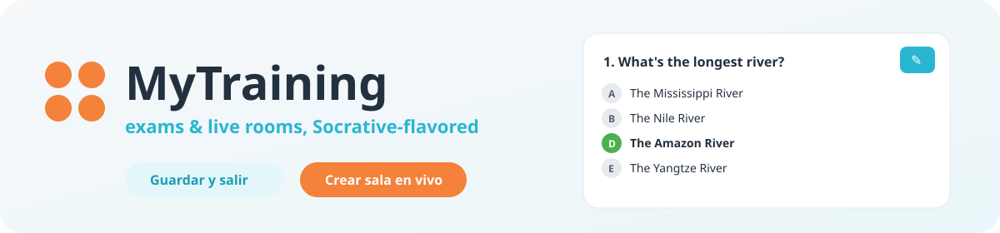
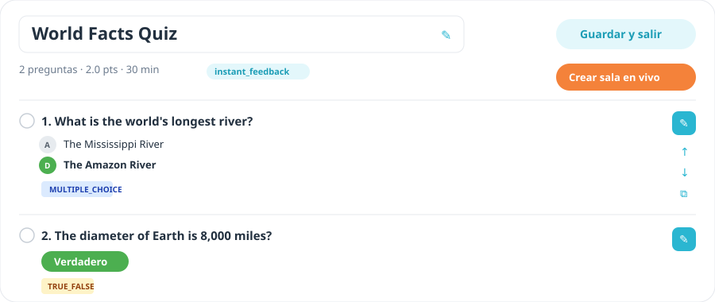
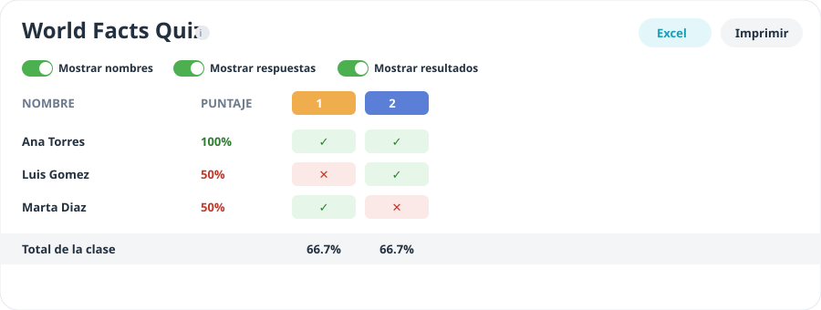
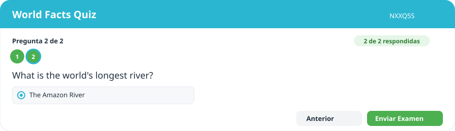

# 🐙 MyTraining — exámenes en vivo, con sabor a Socrative

> Módulo de exámenes tipo Socrative, montado sobre Flask + Jinja + Socket.IO, pero con una piel visual rediseñada para que se sienta tan simple e intuitiva como la referencia real que nos pidió el cliente.




---

## ✨ ¿Qué es esto?

Es la **segunda versión del frontend** de `modular_exams`: mismo backend, misma base de datos, mismas rutas — pero con el constructor de exámenes, la sala en vivo y los reportes redibujados para que se parezcan (en flujo y en sensación) a la app real de Socrative que el profe ya usa a diario.

No es un clon 1:1 del código de Socrative (eso ni es legal ni el punto). Es **nuestra** app, con **nuestros** datos, imitando lo que sí funciona bien de su UX: título editable, opciones con letras, correcta en verde, botones tipo píldora y una barra de acciones que no marea.

## 🖼️ Cómo se ve

### Constructor de examen
Título editable, preguntas con opciones lettradas (A, B, C…), la correcta resaltada en verde, y un riel de iconos compacto para editar / mover / duplicar / eliminar.



### Resultados en vivo (Live Results)
La matriz de la sesión ahora se ve como el "Live Results" real: encabezados de pregunta con color, celdas verde/rojo con la respuesta del estudiante, y tres switches (nombres / respuestas / resultados) para presentar en clase sin regar el chisme antes de tiempo.



### Presentar examen (vista del estudiante)
Puntos de progreso clicables arriba de cada pregunta — de un vistazo sabes qué falta, sin importar si el orden es aleatorio. El botón de enviar ya no se esconde en la última pregunta.



> Las imágenes son mockups ilustrativos hechos a mano con los mismos tokens de color de `base.html` — no capturas de la app real de Socrative (esa la dejamos quietecita, allá en su dominio, con copyright y todo).

## 🧠 Qué trae por debajo

- **Banco de preguntas** con 6 tipos: selección única, selección múltiple, verdadero/falso, respuesta abierta, emparejamiento y ordenamiento.
- **Constructor único** por examen: agrega desde el banco, al azar, o crea preguntas nuevas con píldoras de "agregar en blanco".
- **Salas en vivo** con Socket.IO: orden original o aleatorio, pausa/reanuda, preguntas guiadas por el profesor.
- **Reportes** con matriz de resultados, desglose por pregunta y por estudiante, exportación a Excel, y ahora la vista tipo "Live Results".
- **Preguntas en videos (RF-011)**: en preguntas del banco y en bloques de video de Learning Builder, la pregunta aparece (y el video se pausa) al llegar al minuto configurado. Los tiempos se guardan como JSON (`video_metadata` / `configuracion.cues`) y el contenido de la pregunta solo se envía al navegador cuando llega su momento.
- **Retroalimentación automática**: genera un curso de refuerzo en Learning Builder para quienes saquen menos del 40%.

## 🛠️ Cómo levantarlo en local

```bash
python -m venv venv
./venv/Scripts/activate        # en Windows (Git Bash: source venv/Scripts/activate)
pip install -r requirements-dev.txt   # incluye pre-commit y ggshield
pre-commit install             # escaneo de secretos (GitGuardian) antes de cada commit y push
cp env.example .env
python run.py
```

> 🔐 El hook de **ggshield** necesita una clave de GitGuardian (`ggshield auth login` o `GITGUARDIAN_API_KEY`). En GitHub corre el mismo escaneo en cada push. Si detecta algo, no lo saltes: lee el [Manual de desarrollo §2.4](docs/MANUAL_DESARROLLO_Y_DEPURACION_2026-10-15.md#24-escaneo-de-secretos-gitguardian--ggshield).

Y ya, entras a `http://127.0.0.1:5000`. En desarrollo (`APP_ENV=development`, el valor por defecto) se siembra un profesor demo y puedes crearte una cuenta de tipo **Profesor / Instructor** desde "Crear Cuenta".

### Correr las pruebas

```bash
pytest          # 116 tests
```

## 🚀 Pre-producción

Un solo contenedor, Gunicorn con **1 worker** (las salas en vivo viven en memoria) y SQLite en modo WAL sobre un disco persistente. PostgreSQL llega cuando la base de usuarios pague el cambio; los disparadores están en el SAD.

```bash
docker build -t mytraining .
docker run -d -p 8080:8080 \
  -e SECRET_KEY="$(python -c 'import secrets;print(secrets.token_hex(32))')" \
  -e SUPERUSER_EMAIL=tu@correo.com -e SUPERUSER_PASSWORD="$(cat /ruta/segura/superuser_password)" \
  -v mytraining-data:/data -v mytraining-uploads:/srv/app/app/static/uploads \
  mytraining
curl localhost:8080/healthz
```

- Fuera de `development` **la app no arranca** sin `SECRET_KEY` y `SUPERUSER_PASSWORD` propias. En desarrollo, si las dejas vacías, se generan aleatorias y la contraseña se imprime una vez en la consola.
- Pon delante un proxy con HTTPS (Nginx, Caddy o el balanceador de GCP); las cookies son `Secure`.
- Los profesores los crea el superusuario. Para permitir que se registren solos: `ALLOW_INSTRUCTOR_SIGNUP=true`.
- Respaldo diario: `python scripts/backup_sqlite.py /data/mytraining.db /backups --keep-days 30`.
- Todas las variables están en [`env.example`](env.example).

**Límite conocido:** ~45 estudiantes enviando el examen en el mismo segundo por instancia (p95 ≤ 2 s). Con envíos escalonados, una sala de 100 va bien.

## 📚 Documentación

| Documento | Qué tiene |
|---|---|
| [`docs/SRS_2026-10-15.md`](docs/SRS_2026-10-15.md) | Requisitos (funcionales, no funcionales, reglas, legales), su estado y los límites de la fase |
| [`docs/SAD_2026-10-15.md`](docs/SAD_2026-10-15.md) | Arquitectura real, decisiones (ADR) y despliegue por fases |
| [`docs/MANUAL_USUARIO_2026-10-15.md`](docs/MANUAL_USUARIO_2026-10-15.md) | Guía para profesores y estudiantes |
| [`docs/MANUAL_ADMINISTRADOR_2026-10-15.md`](docs/MANUAL_ADMINISTRADOR_2026-10-15.md) | Instalación, usuarios, respaldos, monitoreo y solución de problemas |
| [`docs/MANUAL_DESARROLLO_Y_DEPURACION_2026-10-15.md`](docs/MANUAL_DESARROLLO_Y_DEPURACION_2026-10-15.md) | Invariantes, mapa del código, recetas y depuración (personas y agentes) |
| [`docs/AUDITORIA_PREPRODUCCION.md`](docs/AUDITORIA_PREPRODUCCION.md) | Hallazgos corregidos, prueba de carga, límites y cuándo pasar a PostgreSQL |
| [`SOCRATIVE_MODULE.md`](SOCRATIVE_MODULE.md) | Rutas y modelos del módulo de exámenes |

## 🎨 Sistema de diseño

Todo el rediseño vive en un puñado de clases nuevas dentro de [`app/templates/base.html`](app/templates/base.html), con prefijo `soc-` (de socrative, no de "socio" 😉):

| Token | Para qué |
|---|---|
| `--primary` (cian) | botones de acción, iconos, enlaces |
| `--accent-orange` | CTAs principales ("Crear sala en vivo", logo) |
| `--success` (verde) | respuestas correctas, toggles activos |
| `.soc-btn-pill-*` | botones tipo píldora |
| `.soc-opt-badge` | círculos con letras (A, B, C…) de las opciones |
| `.soc-icon-rail` / `.soc-icon-btn` | riel de acciones compacto por pregunta |
| `.soc-live-*` | grilla de resultados en vivo |
| `.step-dot` | puntos de progreso en la vista del estudiante |

## 📌 Notas honestas

- Este repo **no comparte historial ni remoto** con `modular_exams` — se sembró como copia independiente a propósito.
- El diseño se inspira en capturas reales que el cliente compartió de su propia cuenta de Socrative, usadas solo como referencia visual — no se reutiliza marca, logo ni código de Socrative/Showbie.
- Sigue en construcción: biblioteca, clases y salas heredan la paleta nueva pero aún no tienen el mismo rediseño de layout que el constructor y los reportes.
- Antes de abrir a usuarios reales falta lo legal (política de tratamiento y autorización, Ley 1581) y el temporizador del examen. Detalle en el [SRS](docs/SRS_2026-10-15.md).

---

Hecho con 🧉, muchos `git commit` y cero paciencia por los botones que se esconden cuando no deberían.
